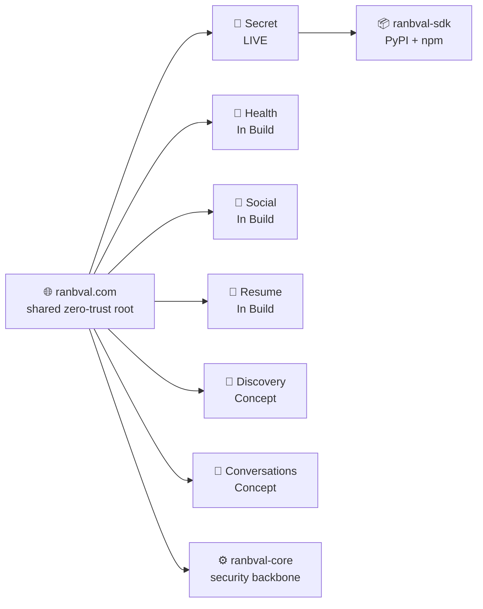

<!-- ╔══════════════════════════════════════════════════════════════════╗ -->
<!--                       AHSAN TARIQ · README                        -->
<!-- ╚══════════════════════════════════════════════════════════════════╝ -->

<div align="center">

<a href="https://ahsantariq.ranbval.com">
  
</a>

<a href="https://ahsantariq.ranbval.com">
  
</a>

<br/>

<p>
  <a href="https://ahsantariq.ranbval.com"></a>
  <a href="https://www.linkedin.com/in/ahsan-tariq-comp-engr/"></a>
  <a href="mailto:ahsantariq0724@gmail.com"></a>
  <a href="https://ranbval.com"></a>
  <a href="https://github.com/ahsantariq7"></a>
</p>

<p>
  <a href="https://leetcode.com/u/ahsantariq7/"></a>
  <a href="https://www.kaggle.com/engrahsantariq"></a>
  <a href="https://orcid.org/0009-0005-0673-8369"></a>
  
  
  
</p>

</div>

---

## 👋 Hi, I'm Ahsan

I build smart systems that run businesses on their own. Given a business problem, I design the AI-powered fix, ship it to production, and keep it running. I work as an **AI/ML Engineer and Forward Deployed Engineer**: autonomous multi-agent workflows, accounting and ERP automations, voice AI, vector search / RAG, and zero-trust cryptographic infrastructure.

I'm the founder of **[Ranbval](https://ranbval.com)** and co-built **[Volvexer](https://www.volvexer.com/)**. My foundation is Computer Systems Engineering (robotics, embedded, networks), which I now combine with GenAI and LLMOps.

```yaml
name:      Ahsan Tariq
role:      AI/ML Engineer · Forward Deployed Engineer
now:       Lead AI Automation & Backend Systems Architect @ Savvy Programmers (Lahore)
building:  Ranbval, a privacy-first suite of AI products on one zero-trust root
studying:  M.S. Computer Systems Engineering, IUB (2026 – 2028)
focus:     [ Multi-Agent LLMs · RAG & Vector Search · Voice AI · Zero-Trust Security · Cloud Run ]
reach me:  ahsantariq0724@gmail.com
motto:     "First solve the problem. Then write the code."
```

<div align="center">

### 🚪 Pick your portfolio mode

<a href="https://ahsantariq.ranbval.com"></a>
<a href="https://ahsantariq.ranbval.com"></a>

<sub>The portfolio has a toggle: same projects, explained for your background.</sub>
<br/>
<a href="https://ahsantariq.ranbval.com/Ahsan_Tariq_Portfolio.pdf">📄 Portfolio PDF</a> · <a href="https://ahsantariq.ranbval.com/Ahsan_Tariq_Case_Studies.pdf">📚 Case Studies PDF</a> · <a href="https://ahsantariq.ranbval.com/case-studies/index.html">🗂 All 24 case studies</a>

</div>

---

## 📊 At a glance

<div align="center">

| 🚢 Production systems | 📚 Case studies | 📦 Package downloads | 🌍 Client countries | 🧪 Peer-review certificates |
|:---:|:---:|:---:|:---:|:---:|
| **20+** | **24** | **11,500+** <sub>(PyPI + npm)</sub> | **USA · UK · Europe · LatAm** | **5** <sub>(WoS-verified)</sub> |

</div>

---

## 🌐 The Ranbval ecosystem

*One root domain, one zero-trust identity, many AI-native products.*



| Product | What it is | Status |
|---|---|---|
| 🔐 **[Ranbval Secret](https://secret.ranbval.com)** | Encrypted API-key vault that ends plaintext `.env` leaks: repository-bound signed tokens, runtime SDKs, live telemetry |  |
| 🏥 **[Ranbval Health](https://health.ranbval.com)** | AI clinical companion and zero-knowledge encrypted health-record vault |  |
| 🧠 **[Ranbval Social](https://socialapp.ranbval.com)** | AI social platform: multi-persona companions, encrypted media vault, relationship intelligence ([case study](https://ahsantariq.ranbval.com/case-studies/ranbval-social/index.html)) |  |
| 📄 **[Ranbval Resume](https://resume.ranbval.com)** | Interactive, verifiable AI resume: recruiters talk to a candidate twin and see real proof of work |  |
| 🔭 **[Ranbval Discovery](https://discovery.ranbval.com)** | Autonomous research agent: reads papers, maps citations, finds research gaps |  |
| 💬 **[Ranbval Conversations](https://conversations.ranbval.com)** | One inbox for WhatsApp, email and social with persistent client memory ([case study](https://ahsantariq.ranbval.com/case-studies/ranbval-conversations/index.html)) |  |
| ⚙️ **[ranbval-core](https://ahsantariq.ranbval.com/case-studies/ranbval-core/index.html)** | Python security backbone: ASGI payload decryption, Redis JWT revocation, OpenTelemetry, 100% CI coverage | internal |

**SDKs:** [](https://pypi.org/project/ranbval-sdk/) [](https://www.npmjs.com/package/ranbval-sdk)

---

## 💼 Selected client work

*Real systems, running for real businesses. Click a title for the full case study.*

| Project | What I built | Headline result |
|---|---|---|
| **[Ambica (Dovetail)](https://ahsantariq.ranbval.com/case-studies/ambica-dovetail/index.html)** | Multi-tenant ops portal on GCP Cloud Run: live NetSuite SuiteQL mirror, fleet and air telematics, role-based RAG | 37 modules · approvals in under 60 s · 100% paperless |
| **[Terry Properties](https://ahsantariq.ranbval.com/case-studies/terry-accounting/index.html)** | AI accountant: Gmail/WhatsApp invoices → OCR → dedup → Buildium + QuickBooks | 99.4% OCR accuracy · 88.5% less manual entry |
| **[TRANSACT ULTD](https://ahsantariq.ranbval.com/case-studies/transact-ultd/index.html)** | Voice AI (Retell + Twilio SIP) with live handoff to human reps and IRIS CRM sync | <850 ms voice latency |
| **[Qira AI](https://ahsantariq.ranbval.com/case-studies/qira-ai/index.html)** | Digital-twin avatar backend: MediaPipe 468-pt mesh, cached TTS, EN↔RU translation | <100 ms cached TTS |
| **[ProspectIntelligence](https://ahsantariq.ranbval.com/case-studies/prospect-intelligence/index.html)** | Sales copilot with Gemini 2.5 Pro explicit context caching | 90%+ token-cost cut · <840 ms |
| **[hddisenos](https://ahsantariq.ranbval.com/case-studies/hddisenos-automation/index.html)** | Self-hosted automation platform: 57 production pipelines (Gemini, HubSpot, Zoho) | 60% less manual workload |
| **[2456.ai](https://ahsantariq.ranbval.com/case-studies/2456-ai-platform/index.html)** | Django + FastAPI hybrid, Pinecone search over 5,000+ tools, LangChain DAG workflows | <25 ms vector search |
| **[InstaMailAI](https://ahsantariq.ranbval.com/case-studies/instamail-ai/index.html)** | MongoDB Atlas Vector Search + RAG for email intelligence | <18.2 ms p95 · 94.8% draft acceptance |
| **[Jericho AI](https://ahsantariq.ranbval.com/case-studies/jericho-ai-multicloud/index.html)** | Multi-cloud GenAI-Ops swarm across AWS, Azure, GCP, IBM, OCI | 38.4% average cloud-cost cut |

<details>
<summary><b>More case studies (8)</b></summary>
<br/>

| Project | What I built |
|---|---|
| **[QPharma](https://ahsantariq.ranbval.com/case-studies/qpharma-data-platform/index.html)** | AWS Glue / S3 / Lambda pharma data lake, HIPAA & GxP-aware, 65% faster time-to-insight |
| **[Seanz Law Firm](https://ahsantariq.ranbval.com/case-studies/seanz-law-firm/index.html)** | Bilingual (EN/ES) WhatsApp + SMS immigration-intake AI with tri-database sync |
| **[CoreImmersive](https://ahsantariq.ranbval.com/case-studies/coreimmersive-film/index.html)** | Hollywood call-sheet PDF ingestion, union meal-penalty clock, weather radar |
| **[Voice agent + scheduling](https://ahsantariq.ranbval.com/case-studies/django-voice-agent/index.html)** | Django + Retell + Cal.com + Recall.ai: books meetings, then joins and summarises them |
| **[Ballyhass Adventure](https://ahsantariq.ranbval.com/case-studies/ballyhass-booking/index.html)** | Voiceflow booking assistant with live capacity API and zero hallucinated availability |
| **[Petroski Physio](https://ahsantariq.ranbval.com/case-studies/petroski-physio/index.html)** | Monday.com + Zapier + Slack two-board automation, one-click therapist approvals |
| **[Universal AI Reel Generator](https://ahsantariq.ranbval.com/case-studies/universal-ai-reel-generator/index.html)** | Audio-to-video pipeline: Qwen2.5-7B storyboard, LCM-DreamShaper scenes, karaoke captions (open source, see below) |
| **[Ranbval-Core](https://ahsantariq.ranbval.com/case-studies/ranbval-core/index.html)** | Microservice security framework used across the Ranbval ecosystem |

</details>

---

## 🔬 Research & open source

| Work | Type | Status |
|---|---|---|
| **ANOVA F-Test Feature Selection for ML-Based Network Intrusion Detection on UNSW-NB15**: 98.67% binary accuracy, 15 of 49 features | Paper · JISRC (SZABIST) | ✅ Accepted, in production |
| **Trust as a Gate, Not a Weight**: robust federated aggregation for safety-critical perception, holds up to 45% Byzantine clients | Paper · JISRC | 📝 Under review |
| **Ranbval Secret Manager**: replacing plaintext `.env` files with encrypted, repository-bound, zero-knowledge security | Paper · JISRC | 📝 Under review |
| **Three Paradigms, One Benchmark**: CLIP vs FPN–Attention vs autoencoders on MVTec AD | Benchmark study | [Read](https://ahsantariq.ranbval.com/case-studies/mvtec-defect-benchmark/index.html) |
| **[emotion-analysis](https://pypi.org/project/emotion-analysis/)**: fuzzy-rough nearest neighbours + BERT/RoBERTa for tweet emotion detection | PyPI package + paper | ✅ Published · [GitHub](https://github.com/ahsantariq7/emotion_analysis) |
| **[isgc](https://pypi.org/project/isgc/)**: SGPA/CGPA analytics for university transcripts | PyPI package + paper | ✅ Published · [DOI 10.5281/zenodo.12688032](https://doi.org/10.5281/zenodo.12688032) · [GitHub](https://github.com/ahsantariq7/isgc) |
| **[ranbval-reel-generator](https://github.com/ahsantariq7/ranbval-reel-generator)**: one audio file → captioned AI vertical reel (Colab, MIT) | 🎁 Open source | ✅ New |
| **[Linux Monitoring System](https://github.com/ahsantariq7/Linux-Monitoring-System)**: webcam intruder capture + SMTP alert on login | Open source | ✅ Published |

```bash
pip install ranbval-sdk      # zero-knowledge secrets for Python
npm  install ranbval-sdk     # same, for Node.js
pip install emotion-analysis
pip install isgc
```

---

## 🛠 Tech stack

<div align="center">

**Languages**<br/>


**Backend · Frontend · AI**<br/>
<br/>


**Data & Vector Stores**<br/>


**Cloud & DevOps**<br/>


**Robotics & Edge**<br/>


</div>

---

## 🧭 Career journey

<table>
<tr>
<td width="170" valign="top"><b>2026 – Now</b><br/><sub>Lahore · Onsite</sub></td>
<td><b>🚀 Lead AI Automation & Backend Systems Architect</b> · <i>Savvy Programmers</i><br/>Qira, n8n + Gemini automation ecosystems, Monday.com + Zapier CRM governance, Voiceflow booking AI, multi-agent LinkedIn intelligence pipelines.</td>
</tr>
<tr>
<td valign="top"><b>2026 – Now</b><br/><sub>Global</sub></td>
<td><b>🛠 Founder & Product Engineer</b> · <i>Ranbval</i><br/>Architecture, backend, SDKs and deployment for the Ranbval product suite. Co-builder of <a href="https://www.volvexer.com/">Volvexer</a>.</td>
</tr>
<tr>
<td valign="top"><b>2025 – 2026</b><br/><sub>Remote · USA</sub></td>
<td><b>⚡ AI Engineer, Backend & DevOps</b> · <i>Ambica International</i><br/>Multi-tenant FastAPI portal on GCP Cloud Run, live NetSuite sync, DocuSign + MS Graph + OAuth, full CI/CD.</td>
</tr>
<tr>
<td valign="top"><b>2024 – 2025</b><br/><sub>Remote · USA</sub></td>
<td><b>🔧 Backend Software Engineer</b> · <i>Artilence</i><br/>QPharma (AWS data engineering), 2456.ai (FastAPI + Pinecone), NVIT (multi-tenant SaaS), Seanz Law Firm (interview AI), LLHAM (multi-agent proposal AI).</td>
</tr>
<tr>
<td valign="top"><b>2025</b><br/><sub>Remote</sub></td>
<td><b>🔁 n8n Engineer</b> · <i>hddisenos</i> (Venezuela) and <b>🧬 Vector DB Engineer</b> · <i>InstaMailAI</i> (USA)</td>
</tr>
<tr>
<td valign="top"><b>2022 – Now</b></td>
<td><b>⭐ Freelance Python Developer</b> · Fiverr · 5-star rating</td>
</tr>
</table>

**🎓 Education:** M.S. Computer Systems Engineering (in progress, 2026 – 2028) and B.S. Computer Systems Engineering (2020 – 2024), both at The Islamia University of Bahawalpur. B.S. capstone funded by the **Ignite National Technology Fund** (Govt. of Pakistan) for ML-based network intrusion detection.

---

## 🏅 Recognition & credentials

- 🔎 **Peer reviewer**, Web of Science verified: *Journal of Engineering Research and Reports*, *Asian Journal of Economics, Business and Accounting*, *Asian Journal of Agricultural Extension, Economics & Sociology* (see [certificates](https://ahsantariq.ranbval.com/#reviewer))
- 💰 **Ignite National Technology Fund grant** (2024) · **PMYP** merit laptop scheme
- 🌍 **NLnet / NGI Code Supply**: Ranbval Secret Manager open-source control-plane proposal currently under technical review
- 🧪 **Kaggle Learn** certificates (ML, feature engineering, SQL, visualization) · **freeCodeCamp** Data Analysis with Python
- 🆔 **Web of Science ResearcherID:** [OMK-7734-2025](https://www.webofscience.com/wos/author/record/OMK-7734-2025)

---

## 📈 GitHub at a glance

<div align="center">


<br/>


</div>

---

## 🤝 Let's build something

<div align="center">

Got a repetitive problem that costs you time or money? Or want to argue about LangGraph vs vanilla agents? My inbox is open.

<a href="mailto:ahsantariq0724@gmail.com"></a>
<a href="https://ahsantariq.ranbval.com"></a>
<a href="https://www.linkedin.com/in/ahsan-tariq-comp-engr/"></a>
<a href="https://ranbval.com"></a>

<br/><br/>


<sub><i>Built with too much coffee and a strong opinion on production-grade Python ☕</i></sub>

</div>
